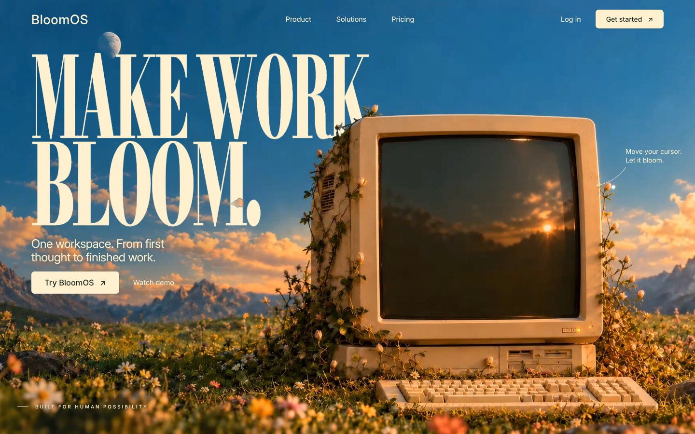
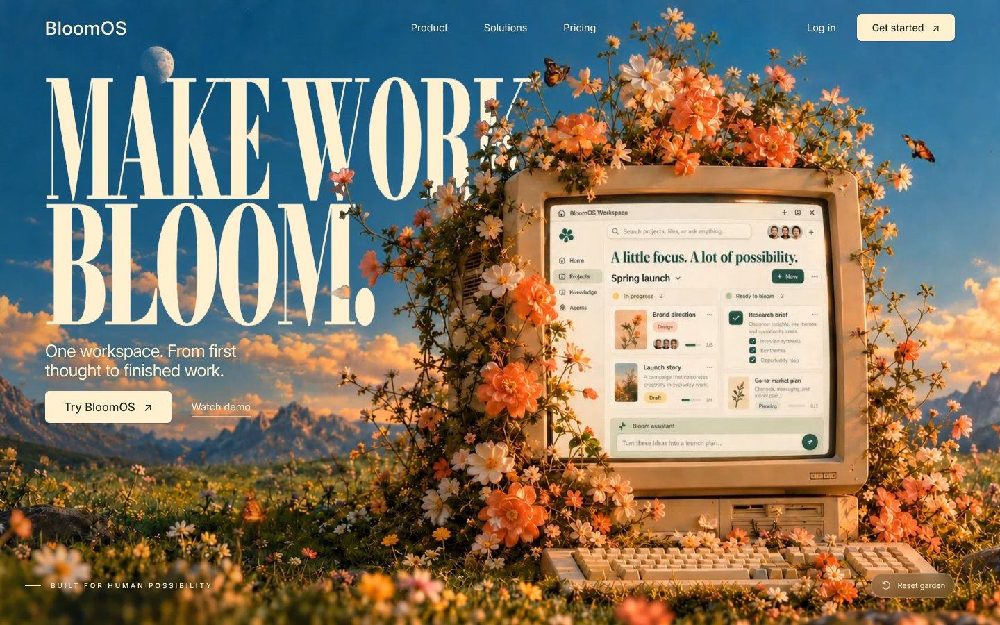

# BloomOS — Make work bloom

A cinematic SaaS landing-page template. Move the cursor over the scene and a soft spotlight reveals a retro computer in a sunset meadow bursting into bloom, only where you move, while the vines and flowers grow **in front of** the headline. Behind the hero is a small working site: Product, Solutions, Pricing, Log in, a 3-step sign-up, and a demo workspace.

Plain HTML/CSS/JavaScript with no dependencies or build step.

| Idle | Bloomed |
|---|---|
|  |  |

## Run locally

```bash
npm run dev        # Node 22+, then open http://127.0.0.1:5173/
```
Any static server works. Media must be served from the same origin, because the WebGL occluder reads video pixels.

## Highlights

- **Cursor spotlight reveal:** a persistent, soft-edged brush mask follows the pointer and reveals a 3-second bloom video only where you move (`app.js`).
- **Foreground occlusion:** a WebGL canvas redraws the computer and plants above the `<h1>`, keying out the sky inside a soft mask (`assets/media/occlusion-domain.png`). The tagline and buttons always stay on top.
- **Site pages:** hash routes `#/product`, `#/solutions`, `#/pricing`, `#/login`, `#/signup`, `#/workspace` (`pages.js`, `pages.css`).
- **Demo account flow:** plan and template choices carry into sign-up; onboarding sets the workspace name, accent and starter tasks. Everything stays in `localStorage`.
- Responsive (desktop, tablet, 390 px mobile), keyboard accessible, honours `prefers-reduced-motion`.

## Structure

```
index.html            markup for the hero and every page
styles.css            hero, header, base styles
pages.css             inner pages, auth, workspace, footer
app.js                hero interaction + WebGL foreground occluder
pages.js              router, tabs, pricing, log-in, onboarding, workspace
assets/fonts/         Bodoni Moda + Inter (SIL OFL)
assets/media/         bloom-start-v2.webp, bloom-end-v2.webp, bloom-growth-repaired.mp4, occlusion-domain.png
docs/TEMPLATE_SPEC.md full rebuild spec + acceptance checklist
docs/PROMPTS.md       step-by-step prompts for AI builders (e.g. Enter)
docs/reference/       15 screenshots of every state
```

## Rebuilding in an AI builder (React)

Point the builder at this repository and start with:

> Import https://github.com/xutianze007-svg/BloomOS. It's a finished static site. Port it faithfully to React (not a redesign). Read `docs/TEMPLATE_SPEC.md` first; the code at the repo root is the source of truth and `docs/reference/` shows the target result. Keep `assets/` under `/public/assets/` with the same paths. Reply with your component plan before writing code.

Then follow `docs/PROMPTS.md` step by step.

## Notes

BloomOS is a fictional product concept. Prices are illustrative; no real accounts, payments or AI services are connected. Fonts are licensed under the SIL Open Font License (see `assets/fonts/`).
